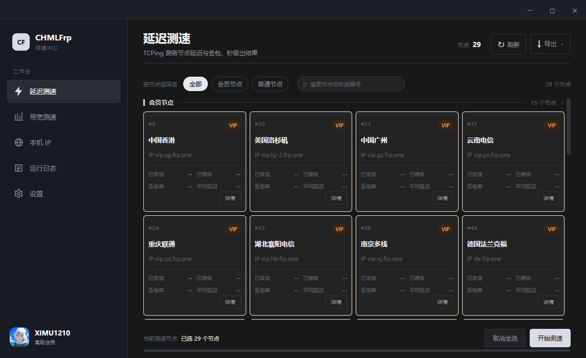

# CHMLFrp-SpeedTest


**CHMLFrp 节点延迟与带宽测速工具**

基于 Wails + Go + 原生 Web 前端构建的桌面应用，帮助你快速筛选延迟低、可用性好的 CHMLFrp 节点。



## 功能概览

- **延迟测速**：并发探测节点端口，通过真实 TCPing 统计平均延迟、收发次数、丢包率，并生成延迟排行榜。
- **节点筛选**：按全部、会员节点、普通节点筛选，也可以按名称或编号搜索。
- **节点信息**：从 CHMLFrp v2 API 获取节点名称、区域、节点组、国内/国外、建站、UDP 和防御等信息。
- **结果导出**：将节点列表和测速结果导出为 CSV 或 PNG 图片；未测速时导出的报告只包含节点清单，结果列留空。
- **带宽测速**：通过 frpc 隧道 + 本地回环测量真实上下行吞吐，提供速率曲线、节点进度、暂停/继续/停止和结果导出。
- **本机 IP 工具**：查看本机网卡地址、当前公网 IP 的大洲、国家/省市、邮编、区号、首都、运营商、ASN、域名、时区与经纬度，并支持查询指定公网 IP。
- **运行日志**：集中查看延迟测速和带宽测速过程中的成功、失败及警告信息；日志按天落盘并保留 7 天，可一键导出成文件。
- **账户与桌面体验**：支持可选的 OAuth2/OIDC 设备码登录、系统托盘、开机自启、关闭窗口隐藏到托盘，以及暗色/亮色/跟随系统主题。

## 当前状态

| 模块 | 状态 | 说明 |
| --- | --- | --- |
| 节点数据 | ✅ 可用 | 从 `https://cf-v2.uapis.cn/node` 拉取并渲染为节点卡片；节点列表免登录，节点真实 IP 需登录后经 `/nodeinfo` 获取 |
| 延迟测速 | ✅ 可用 | 真实 TCPing；需登录；并行探测 `7000`、`80`、`81` 端口，按丢包率和延迟排序 |
| CSV / PNG 导出 | ✅ 可用 | 通过系统保存对话框导出 |
| 本机 IP / 公网归属地 | ✅ 可用 | 本机地址由系统枚举，公网信息来自 ipwho.is（含大洲、首都、区号、时区、旗帜等） |
| 运行日志 | ✅ 可用 | 按天落盘保留 7 天，可导出成文件；界面保留最近 1000 条 |
| 托盘、开机自启、主题 | ✅ 可用 | 开机自启行为随平台实现不同 |
| OAuth2/OIDC 登录 | ✅ 可用 | 内置 Public Client `client_id`，浏览器确认设备码授权，支持环境变量覆盖 |
| 带宽测速 | ✅ 可用 | frpc 隧道 + 本地回环实测上下行吞吐；需登录，测速期间临时创建隧道（占用 1 个配额并消耗流量），测完立即删除 |

## 使用延迟测速

延迟测速需要登录：节点列表本身免登录可拉取，但每个节点的**真实 IP 要用账号令牌通过 `/nodeinfo` 获取**，拿不到 IP 就无法建立 TCP 连接。节点 IP 会在本地缓存 5 分钟（同一账号内复用），点「刷新」可强制重新拉取。

1. 启动应用并登录 CHMLFrp 账号，节点卡片会自动加载。
2. 按节点组筛选（全部 / 会员节点 / 普通节点），或用名称、编号搜索。
3. 点击节点卡片选择目标节点；不选择时默认测速当前筛选出的全部节点。
4. 点击「开始测速」，几秒后查看排行榜或导出结果。

测速参数：每个节点 TCPing 4 次、单次超时 3 秒、最大并发 20；丢包率超过 50% 的节点不计入排行榜。节点可连端口并不统一，`7000`、`80`、`81` 会并行探测，取第一个可连通者用于测速（不硬编码单一端口）。

## 使用带宽测速

带宽测速走真实 frpc 隧道：应用在账号里为每个选中节点临时建一条 TCP 隧道，把节点上的远程端口映射回本机的回环数据源，然后经该隧道**分时打流——先测下行、再测上行，各占一半时长**（两个方向同时打会互相挤占出口带宽，单向上限会明显偏低，所以不做双向并发），测出这条通路的真实上下行吞吐。

1. 先在应用内登录 CHMLFrp 账号（隧道接口需要鉴权，未登录无法建隧道）。
2. 进入“带宽测速”，至少选择一个节点（会真实创建临时隧道、占用配额并消耗流量），再点击“开始测速”。
3. 应用会依次对每个节点：创建临时隧道 → 下载/复用 frpc 并按生成的配置启动 → 测量延迟 → 分时打流（先下行后上行）→ 结束后立即停止 frpc 并删除临时隧道。
4. 单个节点的结果会实时写入节点卡片，结束后可在排行榜查看并导出。

注意事项：

- 测速期间会占用 **1 个隧道配额**（串行执行，同一时间只有一条），并消耗账号流量额度；节点越多、时长越长，消耗越大。
- 单节点时长与单方向连接数可在「设置 → 测速」中调整：时长 5~60 秒（上下行各占一半），连接数 1~8（默认 6）。
- `frpc` 不随程序分发，首次使用会从官方下载表拉取当前平台客户端（sha256 校验）并缓存到用户缓存目录，之后直接复用；也可自行把 `frpc` 放到程序同目录（该位置的副本不做哈希校验，视为你信任的文件）。
- 下载支持断点续传：中途中断会在缓存目录留下 `.part` 文件，下次接着下，不用从头再来 14MB；缓存的客户端在复用前会用 `.sha256` 旁文件复校验，发现损坏自动删除重下。
- 打流时 frpc 会直连节点（已剔除系统代理变量），若你的网络必须经代理才能访问节点，隧道会建立失败并给出日志。

## 登录配置（可选覆盖）

登录使用 OAuth 2.0 设备码授权流程（RFC 8628），不使用或保存 `client_secret`。点击登录后，应用会在系统浏览器中打开授权确认页并显示配对码（形如 `XXXX-XXXX`）；在浏览器中确认后应用自动完成登录，不需要手动输入配对码，也不需要配置本地回调地址。应用已内置 Public Client `client_id`，通常无需额外配置。如需在开发环境切换客户端，可以设置：

```powershell
$env:QZHUA_CLIENT_ID = "你的 client_id"
```

应用的授权请求范围（scope）为 `profile offline_access chmlfrp_api`；邮箱等账户资料由 CHMLFrp `/userinfo` 接口获取。更换 client_id 时，需要保证新客户端在账户中心开启设备码授权并使用兼容的 scope。

## 环境要求

- Windows 10/11：需要 WebView2 Runtime。
- Go 1.25 或更高版本。
- Node.js 20 或更高版本。
- Wails CLI v2.16.0。
- Linux/macOS 构建还需要 Wails 对应的平台依赖。
- 可选：NSIS。装了才有 `.exe` 安装包（`wails build -nsis`），没装则只产出裸 exe。

## 开发与构建

在项目根目录执行：

```bash
# 安装 Wails CLI
go install github.com/wailsapp/wails/v2/cmd/wails@v2.16.0

# 开发模式：启动前端热更新和 Wails 桌面窗口
wails dev

# 构建生产版本，输出到 build/bin/（-clean 会先清空该目录）
wails build -clean
```

构建前请先退出正在运行的程序，否则 exe 被占用会导致写入失败。

用 VS Code 的话，仓库自带了 `.vscode/tasks.json`：`Ctrl+Shift+B` 直接跑 `wails build -clean`，也可从任务列表里选 `wails dev` 或 `go test`。

只调试前端：

```bash
cd frontend
npm install
npm run dev
```

### 测试

```bash
# 全量单元测试：回环打流、frpc 续传与校验、节点过滤、设置项、登录态文件等
go test -tags desktop,production ./...

# 联网校验 ipwho.is 的字段映射（默认跳过，会消耗接口额度）
IPWHO_LIVE=1 go test -tags desktop,production -run TestIPWhoLive -v .
```

`-tags desktop,production` 必须带上，否则 Wails 运行时缺实现，编译直接失败。

### CI

- `.github/workflows/ci.yml`：push 到 `main`/`master` 或提 PR 时自动跑 `go vet` 与 `go test`（windows-latest）。
- `.github/workflows/release.yml`：**手动触发**的三端打包。进入 **Actions → Build → Run workflow** 产出 Windows / Linux / macOS 产物；提交代码不会自动打包。

## 项目结构

根目录下的 Go 文件按职责分组如下（分组只是便于阅读，实际都在根目录）：

```text
.
├── main.go                  # Wails 入口：窗口配置、embed 前端产物
├── app.go                   # 绑定层：前端可调用的方法都在这里
│
├── 延迟测速
│   ├── prefer.go            # 测速流程、节点 IP 关联、排行榜事件
│   ├── ping.go              # TCPing、延迟/丢包/抖动统计
│   └── icmp_*.go            # TCPing 全超时时的 ICMP 兜底探测
│
├── 带宽测速
│   ├── bwtest.go            # 引擎：逐节点建隧道、分时打流、清理
│   ├── bw_tunnel.go         # 隧道 API（列表 / 创建 / 删除）
│   ├── bw_frpc.go           # frpc 下载/续传/校验、配置生成与进程管理
│   ├── bw_server.go         # 本地回环数据源
│   └── bw_proc_*.go         # 各平台隐藏子进程控制台
│
├── 节点与账号
│   ├── nodes.go             # 节点 API、分组过滤、节点 IP 缓存
│   ├── oauth.go             # OAuth2/OIDC 设备码登录与令牌续期
│   └── auth_session*.go     # 登录态持久化（Windows 用 DPAPI 加密）
│
├── 工具与系统
│   ├── tools.go             # 本机网卡枚举与 ipwho.is 归属地查询
│   ├── settings.go          # 设置项读写与取值 clamp
│   ├── runlog.go            # 运行日志落盘与导出
│   ├── tray.go              # 系统托盘
│   ├── autostart_*.go       # 各平台开机自启
│   └── icon_*.go            # 各平台托盘图标资源
│
├── *_test.go                # 单元测试：回环打流、frpc、节点、设置、登录态、ipwho
├── frontend/                # 原生 HTML/CSS/JavaScript 前端
├── assets/                  # 应用展示资源（logo、界面截图）
├── build/                   # Wails 图标、平台配置与构建资源
└── docs/                    # 隐私政策与服务条款
```

## 外部服务

- [CHMLFrp v2 API](https://cf-v2.uapis.cn)：获取节点列表；带宽测速时创建/删除临时隧道。
- [frpc 下载表](https://cf-v1.uapis.cn/download/frpc/frpc_info.json)：按平台拉取 frpc 客户端，不随程序分发；下载后按表中的 sha256 校验，支持断点续传，复用前用 `.sha256` 旁文件复校验。
- [ipwho.is](https://ipwho.is)：查询公网 IP 的地理位置、运营商、ASN、时区与旗帜；免密钥，1000 次/天。
- QZhua OIDC 服务：仅在配置 `QZHUA_CLIENT_ID` 后用于账户登录。

## 法律与隐私

- [隐私政策](./docs/privacy.html)
- [服务条款](./docs/terms.html)

## 许可证

[MIT License](./LICENSE)

## 作者

XiMu · [ximu.setback@qq.com](mailto:ximu.setback@qq.com)
